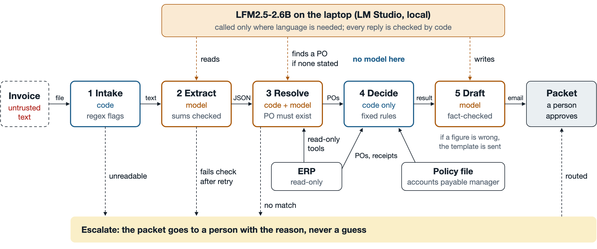

# Invoice exception agent on LFM2.5-2.6B

An agent that takes one supplier-invoice exception from arrival to a resolution a person can approve,
running entirely on a laptop with [Liquid AI's LFM2.5-2.6B](https://huggingface.co/LiquidAI), a small open-weight model with native tool calling. Built for the accounts-payable queue of a
mid-market discrete manufacturer (here, the fictional Ridgeline Fabrication).

**Design in one line:** the model reads, code decides. The model transcribes the messy invoice,
finds the purchase order when the invoice does not say, matches lines by meaning, and writes the
supplier email. Code checks every one of those answers, does the three-way match, applies the AP
policy, and sets the amount to pay. A wrong model answer can cause an escalation or a template
email; it cannot cause a wrong payment.



**Explore the runs:** [juhip.github.io/invoice-exception-agent/explorer](https://juhip.github.io/invoice-exception-agent/explorer/)
(or open `explorer/index.html` locally; it is self-contained). It replays
the ten graded invoices stage by stage, shows every model call and the architecture, lets you move the accounts payable
policy and watch the decisions change, and includes the LFM2.5-2.6B laptop benchmarks.

**Results:** 10 of 10 invoices resolved correctly in the latest graded run (8, then 9, then 10 across
three full runs; the last two on a dataset rebuilt from scratch). Every failure along the way was an
escalation, never a wrong payment. The latest run is in `docs/validation.md`, the rebuilt set's first
run (9 of 10) in `docs/validation_run1_server_error.md`, and the explorer's Results tab lists every failure
and its fix.

## Run it

Start the model (LM Studio, headless; any OpenAI-compatible server works, see `data/model_profiles.json`):

```bash
lms load lfm2.5-2.6b --context-length 8192 --gpu max
lms server start
```

Resolve one exception, or the whole queue:

```bash
python3 run.py --invoice data/invoices/inv_03_large_price_variance.txt
python3 run.py --all data/invoices
```

Each run writes `runs/<timestamp>_<invoice>/` with `packet.json` (every stage's input, output and
flags), `summary.md` (what a person reads to approve), and `model_calls.jsonl` (every prompt, raw
reply, reasoning, tool call, token count and latency).

Grade it against the labeled set, and run the tests (fake model, no server needed):

```bash
python3 evals/run_evals.py            # writes docs/validation.md
python3 -m pytest -q
```

Standard library only (pypdf is optional, for PDF invoices). Python 3.9 or later.

## What is here

| Path | What |
|---|---|
| `run.py` | one command: invoice in, resolution packet out |
| `agent/intake.py` | reads text, email or PDF; code finds PO references (OCR-tolerant), injection and bank-change phrases |
| `agent/extract.py` | **model** transcribes the invoice to a fixed schema; code checks structure and arithmetic, repairs a misread line from the printed amount when that is unambiguous, retries once, escalates |
| `agent/resolve.py` | supplier and PO lookup in code; **model with read-only tools** only when the invoice has no usable PO reference; **model** matches lines without part numbers to PO lines from a fixed candidate list |
| `agent/match.py` | code only: price, quantity vs receipt, freight, duplicate, fraud, policy tolerances, decision, amount to pay, approver |
| `agent/draft.py` | **model** writes the supplier email from a facts packet; code rejects any added number, date, ID or name; template fallback |
| `agent/llm.py` | the model slot: OpenAI-compatible client, per-run call log, JSON retry, tool loop with allowlist and argument schema |
| `agent/erp.py` | the mock ERP over SQLite: purchase orders, receipts, suppliers, catalog, processed invoices; four read-only tools the model may call |
| `data/invoices/` | ten synthetic invoices in different layouts (clean, OCR scan, email thread, duplicate, injection) with labels in `expected.json` |
| `data/policy.json` | the AP matching policy as settings: tolerances, freight cap, auto-approve limit, approvers |
| `prompts/` | the four prompts, plain text |
| `evals/run_evals.py` | grades every invoice; reports per-stage model behaviour; `docs/validation.md` (and `docs/validation_run1_server_error.md`, the first run on the rebuilt dataset, kept as the record of what failed) |
| `tests/` | 22 tests against a fake model server: every decision path and every guardrail |
| `docs/ARCHITECTURE.md` | one page: input, output and failure handling per stage |
| `explorer/index.html` | interactive page: replay each run, the architecture, policy controls, results, model benchmarks |
| `runs/evals/` | the latest graded run: packet, approver summary and every model call per invoice |

## Reused from earlier work

The model client, the no-invented-facts checker and the fake model server come from a
procurement-planning agent I built earlier. The mock ERP, its suppliers and the ten
invoices are new synthetic data built by `data/build_dataset.py` (deterministic; rerun it to reset).
